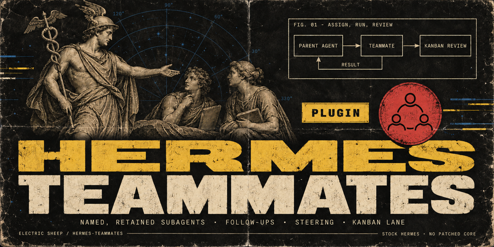
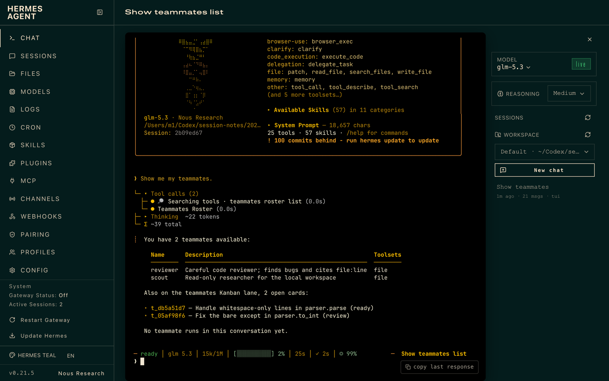
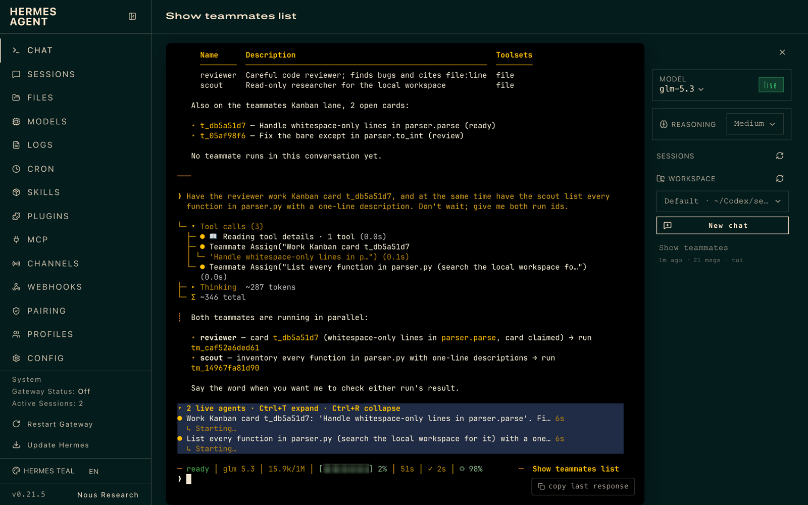
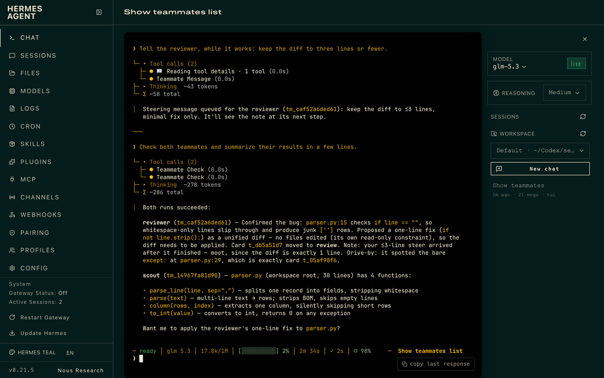
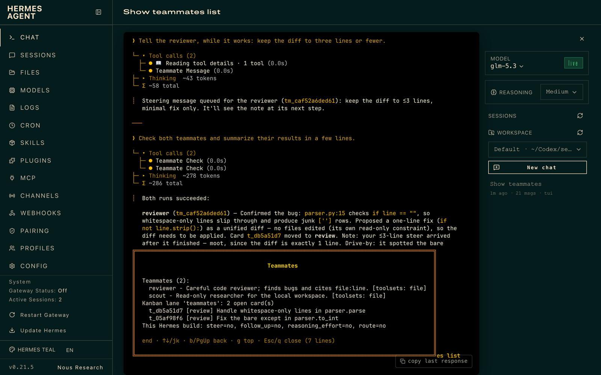

# Hermes Teammates



**Named subagent teammates for [Hermes Agent](https://github.com/NousResearch/hermes-agent).**
You define a small roster of teammates (a reviewer, a scout, a test-writer), each with its own instructions,
toolsets and model. Your agent hands them work, checks on them, steers them mid-run, follows up with the context
of earlier assignments, and can work a Kanban lane with a review handoff.

Stock Hermes; no patched core. It uses the public plugin subagent lifecycle API (`ctx.subagent_lifecycle`).

- **For:** people who already delegate with Hermes and want the same specialists every time, without rewriting
  the brief, and with a durable record of what each teammate did.
- **Not for:** DAG workflows with gates and fan-out. Use
  [hermes-workflows](https://github.com/jacobhausler/hermes-workflows) for those. Teammates is about who does the
  work; workflows is about the shape of a long job.

## Screenshots

| Roster | Two teammates in parallel, one working a Kanban card |
|---|---|
|  |  |
| **Results; the card moved to review** | **`/teammates` in any chat** |
|  |  |

## How it works

```
 you ──► parent agent ──teammate_assign──► teammate (Hermes subagent, your toolsets/model)
              ▲                                  │
              └──────────teammate_check◄─────────┘  result, provider/model, duration
              │
              └─teammate_assign(kanban_task)──► claim lane task ─► run ─► task moves to REVIEW
```

1. You define teammates in config. The model only ever picks a teammate **name**; you decide what that name
   means.
2. `teammate_assign` launches a subagent through `ctx.subagent_lifecycle` and returns a `run_id` at once. The
   teammate's instructions travel in its context. Its toolsets can only narrow the parent's, never widen them.
3. `teammate_check` reports status, or waits up to 60 s and returns the result. Every run is recorded in a
   per-profile SQLite ledger (`<HERMES_HOME>/plugin-data/hermes-teammates/data.db`). Results of plain runs are
   saved when the child finishes, even if you never call `teammate_check`.
4. `follow_up: true` gives the teammate a bounded digest of its earlier assignments in this conversation, so it
   picks up where it left off.
5. `teammate_message` steers a running teammate. The text lands at its next step, without stopping it.
   `teammate_stop` records accepted stops; completions after the stop stay cancelled and block their Kanban card.
   Refused cancellations leave completed work intact.
6. **Kanban teammates lane.** Assign cards to the `teammates` lane, which is not a Hermes profile, so the
   dispatcher leaves them alone. `teammate_assign(kanban_task=…)` claims the card and keeps the claim alive while
   the teammate works. On success the card moves to **review** with the teammate's summary; on failure it is
   **blocked** with the reason. You, or your agent, accept or request changes with the usual Kanban tools.

## Install

```bash
hermes plugins install 100yenadmin/hermes-teammates --enable
```

Then restart the gateway (or the CLI session) so the tools register.

## Configure

**In Hermes Desktop** (0.21.5 or newer), open the plugin's settings. On current builds they are under
**Settings ▸ Plugins**; on 0.21.5 they open inline from the plugin's row under **Capabilities ▸ Plugins**.

| Setting | What it does | Valid values (invalid teammates are refused; other settings fall back to defaults) |
|---|---|---|
| **Teammates** | Your roster, as a JSON object (example below) | Names: lowercase letters, digits, `-` or `_`, up to 32 characters |
| **Kanban lane** | Kanban assignee for teammate cards | Any name that is not a Hermes profile; default `teammates` |
| **Kanban claim TTL (seconds)** | How long a claim on a lane card lasts between heartbeats | 60–86400; default 900 |
| **Max live runs per conversation** | Teammate runs one conversation may have in flight | 1–16; default 4 |
| **Follow-up context budget (characters)** | How much of earlier results a follow-up carries | 0–24000; default 8000 |

The **Teammates** field takes JSON like this:

```json
{
  "reviewer": {
    "description": "Careful code reviewer; finds regressions and cites file:line.",
    "instructions": "Review the change you are given. Report findings with file:line and a fix.",
    "toolsets": ["file", "terminal"]
  },
  "scout": {
    "description": "Fast web researcher.",
    "instructions": "Find the facts asked for. Quote sources.",
    "toolsets": ["web"]
  }
}
```

Each teammate takes `description`, `instructions` and `toolsets`, plus optional `model`, `route` and
`reasoning_effort` (see [Compatibility](#compatibility)). The form checks types, not ranges. A value it accepts but
the plugin can't use is listed under **Config problems** in `/teammates`. Invalid teammates refuse launch:
unknown keys, wrong field types, and empty or invalid `toolsets` fail closed. Absent or null `toolsets` inherit.
Long descriptions and instructions are clipped with warnings and remain launchable; toolset names are trimmed.

Launch context reserves operator instructions, then card text (up to 6,000 characters), the follow-up digest,
and caller context, within 30,000 characters. Clipped parts show `[… N characters omitted]`; instructions stay intact.

**With the CLI, headless, or on Hermes 0.21.4,** put the same settings in `config.yaml`:

```yaml
plugins:
  entries:
    hermes-teammates:
      settings:
        teammates:
          reviewer:
            description: "Careful code reviewer; finds regressions and cites file:line."
            instructions: "Review the change you are given. Report findings with file:line and a fix."
            toolsets: [file, terminal]
          scout:
            description: "Fast web researcher."
            instructions: "Find the facts asked for. Quote sources."
            toolsets: [web]
            model: null            # same provider as the parent; see Compatibility
        lane: teammates            # Kanban assignee for the teammates lane (must not be a profile name)
        max_live_runs: 4           # per conversation
        followup_context_chars: 8000
        claim_ttl_seconds: 900
```

Settings are read on every call, so edits apply without a restart. The one exception is the list of teammate
names in the `teammate_assign` tool description, which is fixed at startup. A teammate you add later works by
name right away, and `teammates_roster` always shows the current list; restart to refresh the description.

## Use

Ask in plain language:

> Have the reviewer check the diff in `src/parser.py`, and the scout find how other projects handle BOM-prefixed
> CSV. Report back when both are done.

| Tool | What it does |
|---|---|
| `teammates_roster` | Lists teammates and their current `role_hash`, recent runs, open lane cards and host features; optional `teammate` explains one definition |
| `teammate_assign` | Starts a run: `teammate`, `goal`, optional `context`, `follow_up`, `kanban_task` |
| `teammate_check` | Shows status (including `queued`), result, `api_calls` and `duration_seconds`, or waits (`wait_seconds` ≤ 60) |
| `teammate_wait` | Waits for any or all of 1–16 unique run IDs in this conversation; returns `done`, `pending`, and `timed_out` |
| `teammate_message` | Steers a running teammate |
| `teammate_stop` | Cancels a run |

`/teammates` prints the roster in any chat surface.

`queued` means Hermes has accepted the child and is waiting to start it. Queued runs still count toward the
live-run cap.

### Results and receipts

Finished runs report these fields through `teammate_check`, `teammate_wait` and the roster's recent runs:

| Field | Meaning |
|---|---|
| `summary_clipped` | True when original summary content was cut, even if a stop note adds text afterward |
| `summary_chars` | Original summary length before ledger/public clipping; `null` for old rows or no summary |
| `role_hash` | First 12 SHA-256 hex characters of the canonical JSON of the parsed teammate definition used at launch; `null` for old rows |
| `api_calls`, `duration_seconds` | Lifecycle request count and duration in seconds; `null` when unavailable |
| `tokens_input`, `tokens_output` | Accumulated input and output token buckets from the child's API hooks |
| `tokens_cache_read`, `tokens_cache_write`, `tokens_reasoning` | Accumulated cache and reasoning token buckets, when supplied |

Summaries retain at most 8,000 characters in the ledger; the roster returns at most 300 per run. For old rows,
`summary_clipped` only detects clipping of the stored text because the original length is unknown.
The roster's current `role_hash` can differ from a run's hash after you edit the definition.
Run rows omit `error` when it is null; actual tool errors retain `error` and `ok: false`.

Token receipts require both `subagent_start` and `post_api_request` hooks and in-process plugins; the roster
reports `token_receipts` support. Only mapped child sessions contribute, never the parent's own requests or
unmapped children. Counts are in-process only: unfinished accumulators do not survive reloads or restarts.
Missing, invalid or overflowing buckets are `null`; completed receipts stay in the ledger. The map holds at
most 1,024 sessions, so evicted sessions cannot supply complete receipts. Hermes does not expose cost to plugins.

`teammates_roster(teammate="reviewer")` returns only that teammate and its parsed `definition`, current
`role_hash`, `launch_toolsets` (or `inherits parent`), route support in `features`, ignored fields in
`unsupported`, and read-only global `delegation` values: `inherit_mcp_toolsets`, `worktree_isolation` and
`child_timeout_seconds`. Unset values use Hermes's defaults; `delegation_sources` marks each value as
`config`, `default` or `unknown`. Unavailable values are `unknown`; an unknown name returns `unknown_teammate`.

`teammate_wait(run_ids, mode="any", wait_seconds=30)` returns as soon as any requested run ends;
use `mode="all"` for fan-in. The wait is bounded to 0–60 seconds. Unknown or cross-conversation IDs
return `unknown_run` before waiting. Finished rows omit `goal` and share a summary budget: per-run budget is
`max(1000, 24000 // number_of_done_runs)`. `summary_clipped` reports any cut; `teammate_check` keeps its full
goal and 8,000-character summary budget. Wait skips blocking Kanban handoff retries; the monitor and later
`teammate_check` still produce the handoff outcome.

### Completion notices (not available yet)

Notices that tell the parent when a run ends are built, but no current Hermes build can deliver them safely. Hermes can't
yet confirm which conversation would receive an injected message. In the CLI it goes to whatever session is open, and in the
gateway a chat keeps the same routing key after `/new`. A notice could land in the wrong conversation, so the plugin never
injects one; the roster reports `push_completion` as `unsupported` with the reason. Use `teammate_wait` instead.

Session-bound injection is requested upstream in
[NousResearch/hermes-agent#133212](https://github.com/NousResearch/hermes-agent/issues/133212#issuecomment-6152052854).
Once Hermes has it, a plugin update can enable notices behind `notify_on_completion` (off by default; outside the CLI
also the operator's `allow_gateway_injection`). A notice contains only the teammate name, run ID and status, never child
output, goals or child error text. Runs already read with check/wait or stopped by the parent get no notice.

## Compatibility

- Requires Hermes **0.21.4 or newer**. CI runs against a pinned upstream commit and against `main`.
- Runs with `plugins.isolation: in_process` (the default). Under `plugins.isolation: host`, every tool except the
  roster answers `unsupported_isolation`. Hermes builds with NousResearch/hermes-agent#137167 can carry launches across
  the plugin-host boundary. But calls made after a tool returns (run monitors) cannot yet resolve their parent
  session, and the plugin cannot see the delegation depth or spawn pause from the host process.
- Some features depend on the Hermes build. The plugin detects each one at call time and never quietly
  substitutes something else:

| Teammate setting / feature | Needs in Hermes | When missing |
|---|---|---|
| `model` | any supported version | Must be served by the child's selected provider (normally inherited from the parent) |
| `delegation:` config (provider, model, reasoning effort) | provider and model: builds with #137167; reasoning effort: any supported version | Teammates use the parent's provider and model; `delegation.reasoning_effort` still applies to every teammate |
| `route` (a configured Hermes provider name, such as `openrouter`) | `SubagentLaunchRequest.provider`, in Hermes builds with NousResearch/hermes-agent#137167 (on Hermes main since 2026-10-12; first in the v0.21.7 canary of 2026-10-13; not yet in a stable release) | Listed in the run's `unsupported` field; the run uses the parent's provider. With support, a routed teammate does not use the `delegation:` provider settings (provider, model, base URL, API mode, request overrides); the global `delegation.reasoning_effort` still applies on any build (a per-teammate `reasoning_effort` is the separate row below). Always set `model` together with `route`. |
| `reasoning_effort` | `SubagentLaunchRequest.reasoning_effort` (upstream PR #89936) | Listed in the run's `unsupported` field |
| steering | a lifecycle `steer` (Hermes builds with #137167); older builds fall back to `delegate_task` steer with the live parent | `teammate_message` returns `unsupported` |
| `teammate_wait` | supported lifecycle and in-process plugin | Same isolation restrictions as check |
| push completion | public session-bound injection (unavailable on tested pinned/main); gateway also needs operator consent | Roster reports unsupported; results remain available via check/wait |
| follow-up on the same child | a lifecycle `follow_up` (proposed upstream) | Follow-ups carry earlier results as context |

The upstream proposal is tracked in [NousResearch/hermes-agent#133212](https://github.com/NousResearch/hermes-agent/issues/133212).

## Benchmarks

The first live slice ran one code-review task three ways on the same model (GLM `glm-5.3`, one Hermes build, 3 runs each):
**A** one agent alone, **B** core `delegate_task` fan-out to 4 helpers, **C** 4 teammates.

| Setup | Bugs found (of 8) | Parent tokens | Total tokens | Parent API calls | Wall time |
|---|---:|---:|---:|---:|---:|
| A, one agent | 8 | 135k | 135k | 9 | 87 s |
| B, `delegate_task` | 8 | 32k | 171k | 3.3 | 81 s |
| C, teammates (0.1.3) | 8 | 52k | 195k | 6.3 | 86 s |

All three setups found every planted bug, so this task cannot rank them on quality. It does show the cost shape: delegating cut the parent's cumulative token use 2.6–4.2× (its peak prompt about 1.6×), cost 26–44% more tokens in total, and was not faster here. Teammates made about twice
as many parent calls as `delegate_task`; those were status polls, which `teammate_wait` in 0.2.0 is meant to cut (not yet re-measured).
An audit of every recorded tool call found no run read the answer key. These are means of 3 runs, without significance tests.

Full report, method and per-run data: [`bench/results/slice1/REPORT.md`](bench/results/slice1/REPORT.md). The `$0` mechanics benchmarks
(`tests/bench_mechanics`) run in CI on every change. A harder task and a re-measure with `teammate_wait` are tracked in #16.

## Limits (honest list)

- **Follow-ups carry context, not the transcript.** A follow-up starts a fresh subagent with a digest of earlier
  results until Hermes exposes transcript-level follow-up to plugins.
- **Runs do not survive a restart.** Hermes keeps subagents in-process. After a restart the ledger marks
  unfinished runs from dead processes `interrupted` on first plugin use across conversations; results are not
  recovered or re-run. Plugin reloads within the same process preserve live runs. A lane card's claim expires through Kanban's normal TTL.
- **Runs belong to the conversation that started them.** Another chat on the same profile cannot see, steer or
  stop them.
- **Runs belong to the conversation that started them.** Hermes' default in-place compression (`compression.in_place: true`)
  keeps the session id, so runs survive it. In rotation mode (`in_place: false`) and after `/new`, the conversation gets a new
  session id and earlier runs answer `unknown_run`. A lane card is blocked when its monitor detects the lost handle; the child
  may continue without a recoverable result.
- **Toolsets narrow, but they are Hermes toolsets.** `file` includes write tools, so a teammate with `file` can
  edit files even if its instructions say not to. Pick toolsets for what the teammate may do, not what it should
  do. By default Hermes adds the parent's MCP toolsets back to a teammate with narrowed `toolsets` (`delegation.inherit_mcp_toolsets: true`); set it to `false` for a strict intersection.
- The plugin refuses nested teammates, checks Hermes's spawn-pause flag, and caps live runs per conversation.
- Hermes builds before #137167 cannot grant plugin toolsets (for example Spotify) to teammates; launch returns
  `launch_failed`. Newer builds accept them.

## How to test

```bash
hermes plugins validate --install-deps ./hermes-teammates
cd hermes-teammates && python -m pytest -q   # inside a Hermes venv
```

Manual walkthrough (5 minutes):
1. Add the `reviewer` teammate above, in the plugin settings or `config.yaml`.
2. Ask: "Show me my teammates." You should see the roster with `reviewer` and a features table.
3. Ask: "Have the reviewer summarize README.md in three bullets." You get a `run_id`, then the result via
   `teammate_check`.
4. Ask: "Follow up with the reviewer: which bullet is weakest?" The run starts with `follow_up: true`.
5. Create a Kanban card assigned to `teammates`, then ask: "Have the reviewer work Kanban task <id>." The card
   goes running → review with the summary.

## Security

See [SECURITY.md](SECURITY.md). In short:

- Credentials come from Hermes: the parent's, or the operator-configured provider's when route is supported.
  The model cannot choose credentials; teammates can only narrow toolsets.
- The model picks names, never providers or models.
- The ledger stays local and per profile.
- The plugin makes no network calls of its own.
- It only claims Kanban cards assigned to its lane.

## License

MIT. Maintained by [@100yenadmin](https://github.com/100yenadmin) (Electric Sheep).
