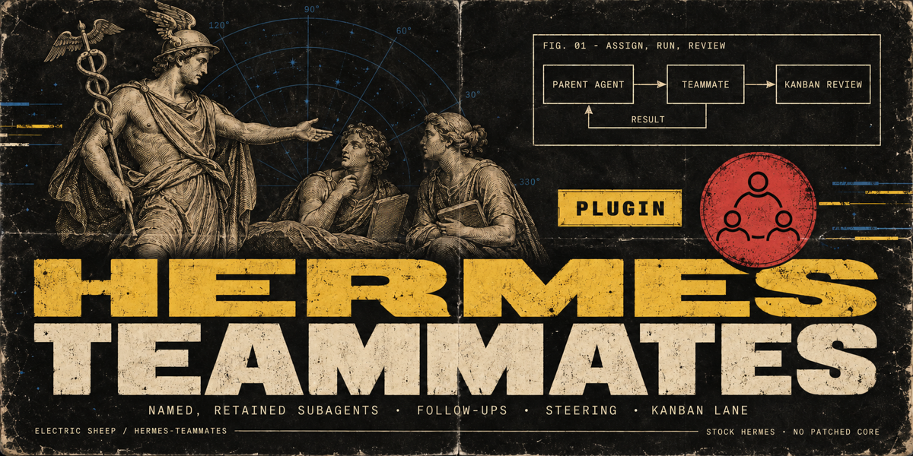
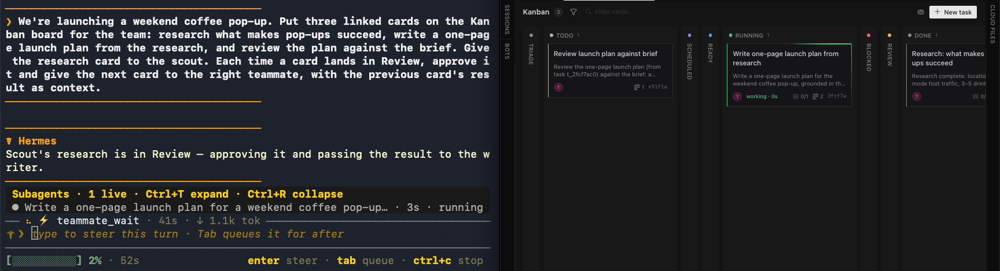
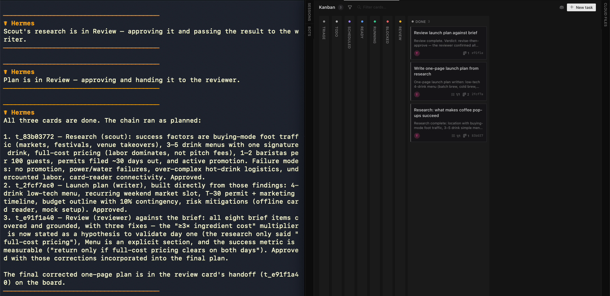
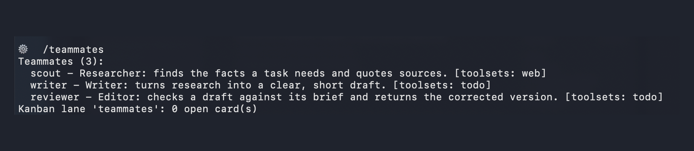
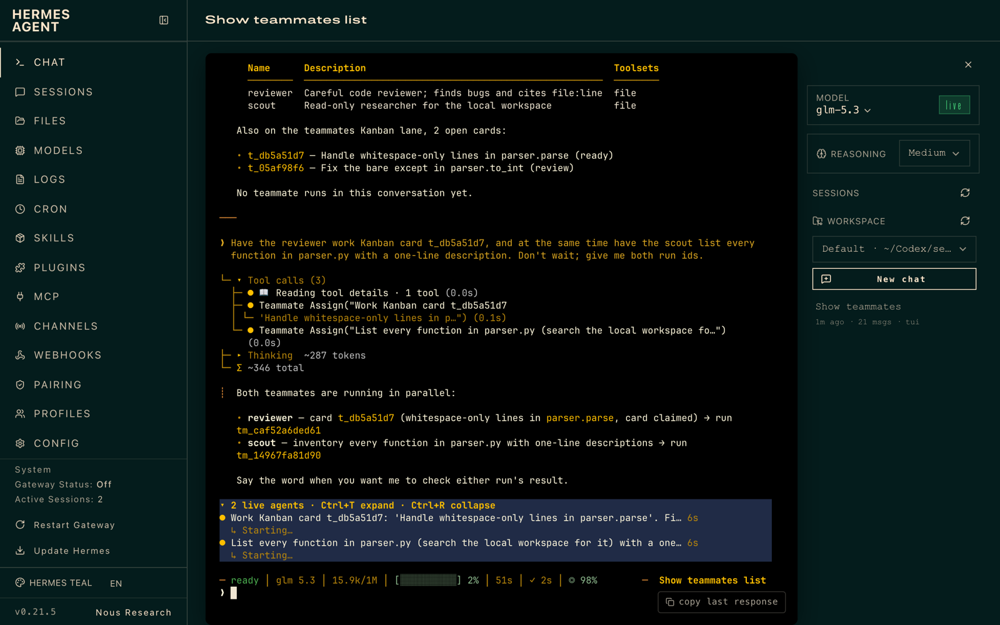
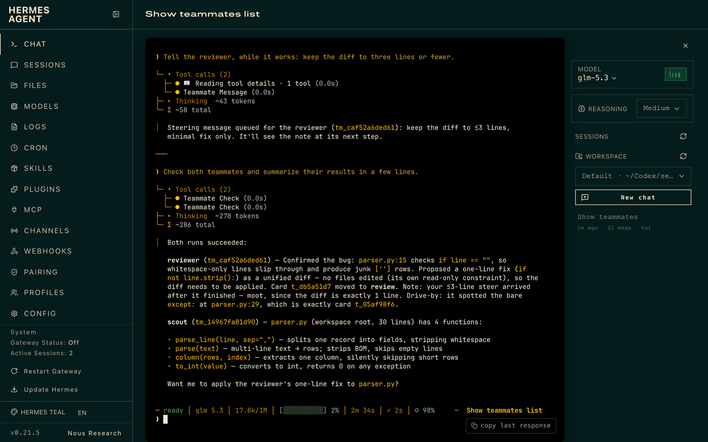
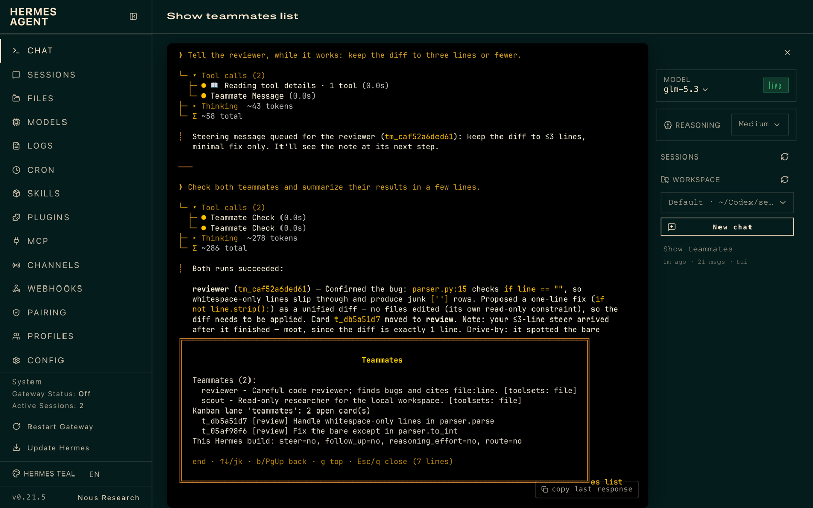

# Hermes Teammates



**Give your [Hermes Agent](https://github.com/NousResearch/hermes-agent) a team.** You define a small roster of
named teammates, such as a scout, a writer and a reviewer. Each has its own instructions, tools and, optionally, its
own model. Your agent hands them work, checks on them, steers them mid-task and follows up with what they did before.
On Hermes' own Kanban board, they work linked cards one after another, and each card a teammate finishes waits in
Review for approval before the next one starts.



One message ran the chain above: research, a one-page plan from the research, then a review of the plan against the
brief. The agent gave each card to a teammate and waited for it. When the card landed in **Review**, the agent
approved it and handed the result to the next teammate. The reviewer, with its own brief and no web or file tools,
marked the plan "Revise" for a pricing claim the research didn't support. It took about 90 seconds, with no further
input.



### What it adds to Hermes

- **A roster the model can't change.** The model picks only a teammate's **name**; your settings decide what that
  name can do. A teammate's toolsets can only narrow the parent's tools, toolset by toolset, so a reviewer given
  only `todo` gets no web, file or terminal tools, whatever the prompt says. (Hermes can add inherited MCP toolsets
  back unless `delegation.inherit_mcp_toolsets` is false.)
- **A teammates lane on Hermes' Kanban board.** Hermes hands board cards to whole Hermes profiles. This lane is
  worked by your roster, inside one conversation. The plugin claims the card and keeps the claim alive while the
  teammate works. It writes the result onto the card and moves the card to **review**; the plugin never completes
  a card. An approval (`kanban_complete`) finishes it and unlocks the cards that depend on it.
- **Background runs with a memory.** Teammates are real Hermes subagents started through the public plugin
  subagent lifecycle API (`ctx.subagent_lifecycle`). The agent can wait for them, steer them or stop them. A
  per-profile ledger records every run's goal, status and result across turns. A follow-up in the same conversation
  carries a digest of that teammate's earlier results, so you don't paste them back in.

Stock Hermes; no patched core.

### Teammates and Hermes' built-in `delegate_task`

Hermes already runs subagents in the background and lets the agent list, steer and stop them. Teammates keeps
that and changes who decides what a subagent is.

| | `delegate_task` (built in) | Teammates |
|---|---|---|
| The brief | The model writes the whole brief, goal and context, on every call | Each teammate's standing instructions live in settings; the model picks a name and gives the task's goal |
| Tools | Every child inherits the parent's toolsets, minus a block list | Each teammate has its own toolsets, narrowed from the parent's: a reviewer on `todo` gets no web, file or terminal tools (Hermes adds inherited MCP toolsets back unless `delegation.inherit_mcp_toolsets` is false) |
| Model | The same delegation model for every child | Optionally one per teammate |
| Record | `action='list'` shows live children; a result arrives once | A SQLite ledger per profile keeps every run's goal, status and complete result (up to 262,144 characters, a 256 KB text cap) across turns and restarts; follow-ups carry a digest |
| Kanban | Board cards go to whole Hermes profiles | A `teammates` lane worked by your roster inside the chat; a finished card goes to review and a failed run blocks its card; the plugin never marks a card done |

Checked against Hermes 0.23.0 and main (`tools/delegate_tool.py`: children are spawned with `toolsets=None`,
"always inherit the parent's toolsets").

- **For:** people who want the same specialists every time, without rewriting the brief, with each teammate's work
  handed to review and a durable record of what each teammate did.
- **Not for:** DAG workflows with gates and fan-out. Use
  [hermes-workflows](https://github.com/jacobhausler/hermes-workflows) for those. Teammates is about who does the
  work; workflows is about the shape of a long job.

## Screenshots

| `/teammates`: the roster and the lane | Two teammates in parallel, one working a Kanban card |
|---|---|
|  |  |
| **Results; the card moved to review** | **`/teammates` in Hermes' dashboard** |
|  |  |

## How it works

```
 you ──► parent agent ──teammate_assign──► teammate (Hermes subagent, your toolsets/model)
              ▲                                  │
              └──────────teammate_check◄─────────┘  result, provider/model, duration
              │
              └─teammate_assign(kanban_task)──► claim lane task ─► run ─► task moves to REVIEW
```

1. You define teammates in config. The model only ever picks a teammate **name**; you decide what that name
   means.
2. `teammate_assign` launches a subagent through `ctx.subagent_lifecycle` and returns a `run_id` at once. The
   teammate's instructions travel in its context. Its toolsets can only narrow the parent's, never widen them.
3. `teammate_check` reports status, or waits up to 60 s and returns the result. Every run is recorded in a
   per-profile SQLite ledger (`<HERMES_HOME>/plugin-data/hermes-teammates/data.db`). Results of plain runs are
   saved when the child finishes, even if you never call `teammate_check`.
4. `follow_up: true` gives the teammate a bounded digest of its earlier assignments in this conversation, so it
   picks up where it left off. `source_run_ids` hands over finished results from any teammate in this conversation verbatim.
   With `follow_up=True`, a source that is the same teammate's own earlier run also appears in the follow-up digest and uses budget twice; leave it out of `source_run_ids` in that case.
5. `teammate_message` steers a running teammate. The text lands at its next step, without stopping it.
   `teammate_stop` records accepted stops; completions after the stop stay cancelled and block their Kanban card.
   Refused cancellations leave completed work intact.
6. **Kanban teammates lane.** Assign cards to the `teammates` lane, which is not a Hermes profile, so the
   dispatcher leaves them alone. `teammate_assign(kanban_task=…)` claims the card and keeps the claim alive while
   the teammate works. On success the card moves to **review** with the teammate's summary; on failure it is
   **blocked** with the reason. To accept a card, approve it (`kanban_complete`). To ask for changes, the agent uses
   `teammate_request_changes(kanban_task=…, feedback=…)`: it reopens the card, records the feedback as a comment and
   starts a teammate again with the feedback and previous result as context; it never completes a card. It works from any chat: for a card another conversation worked, it takes the teammate and the last result from the card itself. The manual route remains
   `hermes kanban reopen-review <card> --reason "what to change"`, followed by `teammate_assign` with that context.
   (Hermes' `kanban_request_changes` tool only returns an active review run to its implementer, and a lane card in
   review has none.)
   Lane cards keep the lane as their assignee; the `teammate` argument picks who works each one. So that agents
   set cards up this way from the start, each new session's prompt carries one short paragraph saying so (on
   Hermes builds with plugin prompt sections; it is left out while the roster has no usable teammate). One request
   can run a chain of linked cards hands-off, in any chat: the agent gives a card to a teammate, waits for it with
   `teammate_wait`, approves the card, and gives the next card to the next teammate, all in one turn. Hermes can
   also wake the chat that created a card when that card reaches review. Messaging chats get this from Hermes
   0.21.6, and Hermes Desktop and CLI chats from 0.22.6. TUI chats don't get it. Cards made with `hermes kanban
   create`, or while `kanban.auto_subscribe_on_create` is `false`, get no automatic subscription, so they wake a
   chat only if you subscribe it yourself (see `hermes kanban notify-subscribe --help`). A wake for a card the agent
   already approved is only a late notice. Setting `kanban.auto_subscribe_on_create: false` stops these notices for new cards,
   and also their automatic completion and block notices; subscribe explicitly if you still want those. It only
   stops new automatic subscriptions: cards made from a subscribed card still inherit its subscription, and existing
   ones stay until `hermes kanban notify-unsubscribe` removes them.

## Install

```bash
hermes plugins install 100yenadmin/hermes-teammates --enable
```

Then restart the gateway (or the CLI session) so the tools register.

## Quick start: the team from the screenshots

This is the roster behind the screenshots above. Paste it into the profile's `config.yaml`; in Hermes Desktop, the
same three entries go in the **Teammates** setting as JSON (see [Configure](#configure)).

```yaml
plugins:
  entries:
    hermes-teammates:
      settings:
        teammates:
          scout:
            description: "Researcher: finds the facts a task needs and quotes sources."
            instructions: "Find the facts asked for with at most three web searches, then stop searching and answer from what you found. Quote your sources. Keep it under 150 words."
            toolsets: [web]
          writer:
            description: "Writer: turns research into a clear, short draft."
            instructions: "Write the requested piece from the material you are given. Plain words, short sections, under 200 words. Reply with the piece itself; don't create files."
            toolsets: [todo]
          reviewer:
            description: "Editor: checks a draft against its brief and returns the corrected version."
            instructions: "Check the draft you are given against its brief and research. Answer in one final reply, text only. Line 1: a one-line verdict that names the problems you found. Then those problems (at most 3, one line each), then the corrected version in under 200 words. Don't call tools or create files."
            toolsets: [todo]
```

The writer and the reviewer get only `todo`, so they have no web, file or terminal tools. If the profile has MCP
servers, also set `delegation.inherit_mcp_toolsets: false`, or Hermes adds their tools back. The chat needs
Hermes' `kanban` toolset so the agent can create and approve cards.

Then send one message:

> We're launching a weekend coffee pop-up. Put three linked cards on the Kanban board for the team: research what
> makes pop-ups succeed, write a one-page launch plan from the research, and review the plan against the brief.
> Give the research card to the scout. Each time a card lands in Review, approve it and give the next card to the
> right teammate, with the previous card's result as context.

You should see three linked cards in the `teammates` lane. Each lands in **Review**; the agent approves it and gives
the next card to the next teammate. The agent's last reply sums up what each teammate did. On a fast model the
chain takes about two minutes: our daily check finished all three cards in 131 seconds with no errors. Watch it on
Hermes Desktop's Kanban page or with `hermes kanban watch`. The approvals come from your message: without "approve
it", each finished card waits in Review for you.

## Configure

**In Hermes Desktop** (0.21.5 or newer), open the plugin's settings. On current builds they are under
**Settings ▸ Plugins**; on 0.21.5 they open inline from the plugin's row under **Capabilities ▸ Plugins**.

| Setting | What it does | Valid values (invalid teammates are refused; other settings fall back to defaults) |
|---|---|---|
| **Teammates** | Your roster, as a JSON object (example below) | Names: up to 32 characters, starting with a lowercase letter, then lowercase letters, digits, `-` or `_` |
| **Kanban lane** | Kanban assignee for teammate cards | Any name that is not a Hermes profile, `none`, `null` or `-`; case and surrounding spaces are ignored; default `teammates` |
| **Kanban claim TTL (seconds)** | How long a claim on a lane card lasts between heartbeats | 60–86400; default 900 |
| **Max live runs per conversation** | Teammate runs one conversation may have in flight | 1–16; default 4 |
| **Follow-up context budget (characters)** | How much of earlier results a follow-up carries | 0–24000; default 8000 |

The **Teammates** field takes JSON like this:

```json
{
  "reviewer": {
    "description": "Careful code reviewer; finds regressions and cites file:line.",
    "instructions": "Review the change you are given. Report findings with file:line and a fix.",
    "toolsets": ["file", "terminal"]
  },
  "scout": {
    "description": "Fast web researcher.",
    "instructions": "Find the facts asked for. Quote sources.",
    "toolsets": ["web"]
  }
}
```

Each teammate takes `description`, `instructions` and `toolsets`, plus optional `model`, `route` and
`reasoning_effort` (see [Compatibility](#compatibility)). The form checks types, not ranges. A value it accepts but
the plugin can't use is listed under **Config problems** in `/teammates`. Invalid teammates refuse launch:
unknown keys, wrong field types, and empty or invalid `toolsets` fail closed. Absent or null `toolsets` inherit.
Long descriptions (over 300 characters) and instructions (over 4,000) are clipped with warnings and remain launchable;
toolset names are trimmed. `model`, `route` and `reasoning_effort` over 100 characters, more than 24 toolsets, or a
toolset name that is not 1–48 printable ASCII characters without spaces make the teammate invalid.

Launch context reserves operator instructions, then card text (up to 6,000 characters), the follow-up digest,
handed-over results, and caller context, within 30,000 characters. Clipped parts show `[… N characters omitted]`; instructions stay intact.

**With the CLI, headless, or on Hermes 0.21.4,** put the same settings in `config.yaml`:

```yaml
plugins:
  entries:
    hermes-teammates:
      settings:
        teammates:
          reviewer:
            description: "Careful code reviewer; finds regressions and cites file:line."
            instructions: "Review the change you are given. Report findings with file:line and a fix."
            toolsets: [file, terminal]
          scout:
            description: "Fast web researcher."
            instructions: "Find the facts asked for. Quote sources."
            toolsets: [web]
            model: null            # same provider as the parent; see Compatibility
        lane: teammates            # Kanban assignee for the teammates lane (must not be a profile name)
        max_live_runs: 4           # per conversation
        followup_context_chars: 8000
        claim_ttl_seconds: 900
```

Settings are read on every call, so edits apply without a restart. The one exception is the list of teammate
names in the `teammate_assign` tool description, which is fixed at startup. A teammate you add later works by
name right away, and `teammates_roster` always shows the current list; restart to refresh the description.

### Roster file

To keep the roster out of `config.yaml`, put it in its own YAML file and point `roster_file` at it:

```yaml
plugins:
  entries:
    hermes-teammates:
      settings:
        roster_file: teammates.yaml   # relative to this profile's Hermes home, or an absolute path
```

The file holds one top-level `teammates` mapping, written exactly like the setting (see `teammates.example.yaml`),
and replaces the `teammates` setting while `roster_file` is set. Every other setting stays in `config.yaml`. Each
teammate is validated as usual. A missing, unreadable or invalid file gives an empty roster and a config problem,
never a failed call. `/teammates` and `teammates_roster` show which file the roster came from. The file is read on
every call, like the other settings. Several profiles can share one roster by pointing at the same absolute path.
`roster_file` is an operator setting: no tool argument can change it. Leave it unset to keep the roster in
`config.yaml`.

## Use

Ask in plain language:

> Have the reviewer check the diff in `src/parser.py`, and the scout find how other projects handle BOM-prefixed
> CSV. Report back when both are done.

| Tool | What it does |
|---|---|
| `teammates_roster` | Lists teammates and their current `role_hash`, recent runs, open lane cards and host features; optional `teammate` explains one definition |
| `teammate_assign` | Starts a run: `teammate`, `goal`, optional `context`, `follow_up`, `source_run_ids` (1–8 finished runs in this conversation), `kanban_task`, `wait_seconds` (0–300, default 0) |
| `teammate_request_changes` | Sends a lane card in Review back for changes: `kanban_task`, `feedback` (up to 4,000 characters), optional `teammate` (default: whoever worked it last) and `wait_seconds` (0–300, default 0). Reopens the card, adds the feedback as a comment and starts a new run on it. It never completes a card |
| `teammate_check` | Shows status (including `queued`), result, `api_calls` and `duration_seconds`, or waits (`wait_seconds` ≤ 60); optional `offset` (integer ≥ 0) pages the result in 8,000-character chunks |
| `teammate_wait` | Waits for any or all of 1–16 unique run IDs in this conversation; returns `done`, `pending`, and `timed_out` |
| `teammate_message` | Steers a running teammate |
| `teammate_stop` | Cancels a run |

Use `teammate_assign(wait_seconds=...)` when you need one result now; use `teammate_wait` for several runs or when you have work to do meanwhile.
These tools include relay guidance with finished summaries: preserve specialist findings, citations and verdict
verbatim when reporting them, and keep the parent's commentary separate.

`/teammates` prints the roster in any chat surface.

`queued` means Hermes has accepted the child and is waiting to start it. Queued runs still count toward the
live-run cap.

### Hermes tool search

On the inspected Hermes [compatibility pin](https://github.com/NousResearch/hermes-agent/blob/1078a4e5f363472c43a50c6738e47e54eab2940c/tools/tool_search.py#L150-L214)
and [main revision](https://github.com/NousResearch/hermes-agent/blob/3b63f7b0a4c7beb9eadbce2f15b9da75d01f5065/tools/tool_search.py#L149-L213),
`tools.tool_search.enabled: auto` defers plugin tools whenever any are available. The default 5% `threshold_pct`
limits the catalog listing, not activation. Neither `defer: []` nor a smaller schema keeps teammate tools direct.
There is no supported selective opt-out at these revisions; [upstream request](https://github.com/NousResearch/hermes-agent/issues/135762).

`teammate_assign`, `teammate_request_changes`, `teammate_wait`, `teammate_check` and `teammates_roster` include short catalog hints and
schema examples for the bridge. If the tool is deferred, use `tool_search` to find its name, then
`tool_describe` for its parameters, then `tool_call` to invoke it. Skip search when the catalog already shows
the exact name. Describing a tool does not make it directly callable. For example, after describing the roster:

```json
{"calls":[{"name":"teammates_roster","arguments":{}}]}
```

Send that object to `tool_call`. Use one entry per teammate invocation, with an `arguments` object and the
actual tool name (never `tool_call` itself). When the tool is directly listed, invoke it normally.

If your model struggles with the bridge, merge this into the active profile's `config.yaml` at the **top level**,
alongside `plugins`, preserving other `tools` settings, then start a new CLI session or restart the gateway:

```yaml
tools:
  tool_search:
    enabled: "off"
```

This makes all enabled local plugin/MCP and otherwise-deferred core tools direct, including `process_manage`;
it cannot select only teammates. More full schemas occupy the parent's context on every request, especially
with many MCP tools. Restore `enabled: auto` and restart to return to deferred discovery.
Setting `tools.tool_search.enabled: "off"` also removes discovery of hosted connector tools (`connectors__*`, such as Gmail, Calendar or Linear) on both inspected Hermes revisions, so keep `auto` if you use Hermes connectors.

In the exploratory Slice 3 comparison, C-eager (global deferral off) used **0.70× parent tokens** and **1.30 fewer
parent calls per request** than C (deferral on), across 60 requests per arm. This compared configuration packages,
including `process_manage` visibility; it did not isolate teammate deferral or these new hints.
Quality/success non-inferiority remains **UNRESOLVED**. See [#56](https://github.com/100yenadmin/hermes-teammates/issues/56)
and the [existing private result card and audit](https://github.com/electricsheephq/bench-evidence/releases/tag/hermes-teammates/slice3-live-run004).
No new model run or cost claim is made by this change.

### Results and receipts

Finished runs report these fields through `teammate_assign(wait_seconds=...)`, `teammate_check`, `teammate_wait` and the roster's recent runs:

| Field | Meaning |
|---|---|
| `summary` | Teammate result text within the existing budget; JSON decoding preserves newlines, quotes and non-ASCII text |
| `relay_instruction` | Guidance to relay findings, citations and verdict verbatim; present on finished assign/wait/check rows with nonempty summaries, with an explicit warning when clipped; the roster includes it once at the top level |
| `summary_clipped` | True when original summary content was cut, even if a stop note adds text afterward |
| `summary_chars` | Original summary length before ledger/public clipping; `null` for old rows or no summary |
| `role_hash` | First 12 SHA-256 hex characters of the canonical JSON of the parsed teammate definition used at launch; `null` for old rows |
| `api_calls`, `duration_seconds` | Lifecycle request count and duration in seconds; `null` when unavailable |
| `tokens_input`, `tokens_output` | Accumulated input and output token buckets from the child's API hooks |
| `tokens_cache_read`, `tokens_cache_write`, `tokens_reasoning` | Accumulated cache and reasoning token buckets, when supplied |

Summaries retain at most 8,000 characters in the ledger; the roster returns at most 300 per run.
When a summary is clipped, the ledger also keeps the complete original result up to 262,144 characters
(256 KB of text; Unicode can take more bytes). `teammate_check` adds `full_result_chars` when this text exists.
Pass `offset=0`, then each returned `next_offset`, to read `result_page` in 8,000-character chunks.
Pages include `result_offset`, `full_result_chars` (retained length), and `full_result_truncated` (true if the cap cut text);
`next_offset` is `null` at the end, including offsets past the end. Without a full result, paging reads the stored summary.
For old rows,
`summary_clipped` only detects clipping of the stored text because the original length is unknown.
The roster's current `role_hash` can differ from a run's hash after you edit the definition.
Run rows omit `error` when it is null; actual tool errors retain `error` and `ok: false`.
Replies remain valid JSON with additive guidance; they do not append a second, unescaped copy of the summary.
If `summary_clipped` is true, describe the summary as incomplete and page the rest with `teammate_check offset`;
do not infer missing findings or a verdict. Results beyond the cap and text clipped before this upgrade cannot be recovered.
The roster's short previews follow the same rule; one top-level instruction points to `teammate_check` for the full retained text.
Follow-up digests preserve result text within their configured budget, tell the teammate to continue from prior results and label results
already clipped in the ledger as incomplete. Further digest clipping keeps its characters-omitted marker.
Kanban review handoffs retain their 4,000-character summary budget and add `summary_chars`, `summary_clipped`
and `relay_instruction` to the existing `hermes_teammates` metadata. These instructions guide the parent;
they do not guarantee that a model relays a result faithfully.

Token receipts require both `subagent_start` and `post_api_request` hooks and in-process plugins; the roster
reports `token_receipts` support. Only mapped child sessions contribute, never the parent's own requests or
unmapped children. Counts are in-process only: unfinished accumulators do not survive reloads or restarts.
Missing, invalid or overflowing buckets are `null`; completed receipts stay in the ledger. The map holds at
most 1,024 sessions, so evicted sessions cannot supply complete receipts. Hermes does not expose cost to plugins.

`teammates_roster(teammate="reviewer")` returns only that teammate and its parsed `definition`, current
`role_hash`, `launch_toolsets` (or `inherits parent`), route support in `features`, ignored fields in
`unsupported`, and read-only global `delegation` values: `inherit_mcp_toolsets`, `worktree_isolation` and
`child_timeout_seconds`. Unset values use Hermes's defaults; `delegation_sources` marks each value as
`config`, `managed`, `default` or `unknown`. Unavailable values are `unknown`; an unknown name returns `unknown_teammate`.
The reply stays within 16,000 characters, measured as JSON with non-ASCII text left unescaped. If an explained
definition would not fit, its instructions are shortened and `instructions_clipped` is true.
When a list is cut short, the reply says how many entries it left out: `runs_omitted` for recent runs and
`lane.cards_omitted` for open lane cards. `lane.cards_waiting` counts every lane card in `todo`, whether it waits on
parent cards or was set to `todo` another way; the rendered roster calls these cards "not ready yet".

Filter or page this conversation's runs with `status`, `search`, `since`, `limit` and `offset`.
`status` accepts `running`, `succeeded`, `failed`, `interrupted`, `cancelled` or `unknown`; `search` is a
case-insensitive literal substring (1–200 characters) in goal, summary or error, including literal `%` and `_`.
`since` is inclusive unix seconds. `limit` is 1–50 (default 20), and `offset` is 0–10000 (default 0).
Combine them with `teammate`, for example `teammates_roster(teammate="reviewer", status="failed", limit=5, offset=5)`.
`runs_total` counts matching rows when status, search, since or offset is given, or runs are omitted;
`runs_omitted` counts matches remaining after the offset and returned page. Invalid values return `invalid_roster`.
Run previews stay at 300 characters; use `teammate_check` for full retained text.

Teammates with runs in this conversation also have `stats`: `runs`, `succeeded`, `failed` (including interrupted
and unknown), `cancelled`, `median_duration_seconds` (ignoring missing durations, or `null` if none), and
`last_run_at` (unix seconds). Stats cover this conversation's history regardless of run filters or paging.
`/teammates` shows a compact stats suffix. Teammates without runs have no `stats` key; stats are dropped before
teammate entries if needed to keep the reply within 16,000 characters, and `stats_omitted` then counts the
teammates whose stats were dropped. Explicit `null` for a filter argument means "not given".

`teammate_wait(run_ids, mode="any", wait_seconds=30)` returns as soon as any requested run ends;
use `mode="all"` for fan-in. The wait is bounded to 0–300 seconds (default 30). Unknown or cross-conversation IDs
return `unknown_run` before waiting. Finished rows omit `goal` and share a summary budget: per-run budget is
`max(1000, 24000 // number_of_done_runs)`. `summary_clipped` reports any cut; `teammate_check` keeps its full
goal and 8,000-character summary budget. Before it replies, wait makes one attempt to hand each finished Kanban
lane card to review, so its reply usually already shows `kanban_outcome`. It waits for that only until its own
deadline (at most 5 s) or a Hermes interrupt, and a slow board finishes it in the background. A `null` outcome means
the handoff hasn't landed yet: check the run before approving its card. Retries stay with the monitor and
`teammate_check`.
Hermes interrupts (`/stop` or a new user message) end a wait promptly, returning `interrupted: true` and
`timed_out: false` with the current finished and pending runs; the teammates keep running. Replies omit
`interrupted` otherwise. Hermes's default tool-call timeout (`tools.sequential_call`) is 420 seconds;
if you lowered it, keep `wait_seconds` below your timeout. `teammate_check` remains bounded to 0–60 seconds.

### Completion notices (not available yet)

Notices that tell the parent when a run ends are built, but no current Hermes build can deliver them safely. Hermes can't
yet confirm which conversation would receive an injected message. In the CLI it goes to whatever session is open, and in the
gateway a chat keeps the same routing key after `/new`. A notice could land in the wrong conversation, so the plugin never
injects one; the roster reports `push_completion` as `unsupported` with the reason. Use `teammate_wait` instead.

Session-bound injection is requested upstream in
[NousResearch/hermes-agent#133212](https://github.com/NousResearch/hermes-agent/issues/133212#issuecomment-6152052854).
Once Hermes has it, a plugin update can enable notices behind `notify_on_completion` (off by default; outside the CLI
also the operator's `allow_gateway_injection`). A notice contains only the teammate name, run ID and status, never child
output, goals or child error text. Runs already read with check/wait or stopped by the parent get no notice.

## Compatibility

- Requires Hermes **0.21.4 or newer**. CI runs against a pinned upstream commit and against `main`.
- Runs with `plugins.isolation: in_process` (the default). Under `plugins.isolation: host`, every tool except the
  roster answers `unsupported_isolation`. Hermes builds with NousResearch/hermes-agent#137167 can carry launches across
  the plugin-host boundary. But calls made after a tool returns (run monitors) cannot yet resolve their parent
  session, and the plugin cannot see the delegation depth or spawn pause from the host process.
- Some features depend on the Hermes build. The plugin detects each one at call time and never quietly
  substitutes something else:

| Teammate setting / feature | Needs in Hermes | When missing |
|---|---|---|
| `model` | any supported version | Must be served by the child's selected provider (normally inherited from the parent) |
| `delegation:` config (provider, model, reasoning effort) | provider and model: builds with #137167; reasoning effort: any supported version | Teammates use the parent's provider and model; `delegation.reasoning_effort` still applies to every teammate |
| `route` (a configured Hermes provider name, such as `openrouter`) | `SubagentLaunchRequest.provider`, in Hermes builds with NousResearch/hermes-agent#137167 (on Hermes main since 2026-10-12, first in the v0.21.7 canary of 2026-10-13, and in the 0.23.0 release) | Listed in the run's `unsupported` field; the run uses the parent's provider. With support, a routed teammate does not use the `delegation:` provider settings (provider, model, base URL, API mode, request overrides); the global `delegation.reasoning_effort` still applies on any build (a per-teammate `reasoning_effort` is the separate row below). Always set `model` together with `route`. |
| `reasoning_effort` | `SubagentLaunchRequest.reasoning_effort` (upstream PR #89936) | Listed in the run's `unsupported` field |
| steering | a lifecycle `steer` (Hermes builds with #137167); older builds fall back to `delegate_task` steer with the live parent | `teammate_message` returns `unsupported` |
| `teammate_wait` | supported lifecycle and in-process plugin | Same isolation restrictions as check |
| `teammate_request_changes` | Kanban `reopen_review_task` | Returns `unsupported` |
| push completion | public session-bound injection (unavailable on tested pinned/main); gateway also needs operator consent | Roster reports unsupported; results remain available via check/wait |
| follow-up on the same child | a lifecycle `follow_up` (proposed upstream) | Follow-ups carry earlier results as context |

The upstream proposal is tracked in [NousResearch/hermes-agent#133212](https://github.com/NousResearch/hermes-agent/issues/133212).

## Benchmarks

The first live slice ran one code-review task three ways on the same model (GLM `glm-5.3`, one Hermes build, 3 runs each):
**A** one agent alone, **B** core `delegate_task` fan-out to 4 helpers, **C** 4 teammates.

| Setup | Bugs found (of 8) | Parent tokens | Total tokens | Parent API calls | Wall time |
|---|---:|---:|---:|---:|---:|
| A, one agent | 8 | 135k | 135k | 9 | 87 s |
| B, `delegate_task` | 8 | 32k | 171k | 3.3 | 81 s |
| C, teammates (0.1.3) | 8 | 52k | 195k | 6.3 | 86 s |

All three setups found every planted bug, so this task cannot rank them on quality. It does show the cost shape: delegating cut the parent's cumulative token use 2.6–4.2× (its peak prompt about 1.6×), cost 26–44% more tokens in total, and was not faster here. Teammates made about twice
as many parent calls as `delegate_task`.
An audit of every recorded tool call found no run read the answer key. These are means of 3 runs, without significance tests.

**Slice 2** re-measured this on 10 harder review cases × 2 runs, with teammates 0.2.2 and `teammate_wait`, against the
same `delegate_task` fan-out. Its declared verdict is INCONCLUSIVE: 4 of 40 runs broke the frozen recipe (3 `delegate_task`,
1 teammates). On the 36 valid runs both found 98% of the planted bugs. The teammates parent still used **1.76× the tokens**
of the `delegate_task` parent (95% bounds 1.48–2.07) and made **3.2 more API calls per run**: about 1.7 calls finding the
plugin's tools behind Hermes's tool search, and 2.3 waits, since a wait is capped at 60 s while helpers ran 150–200 s.
Fixes: a longer wait (#40) and directly listed plugin tools upstream (NousResearch/hermes-agent#135762). For a one-shot
fan-out, `delegate_task` is the cheaper choice today.

**Slice 3** tested what teammates are for: one six-request session that needs three named specialists, a scout, a
reviewer and a tester. It ran on 10 cases, with teammates 0.2.5 against `delegate_task` with the same role rules in
AGENTS.md. The declared verdict is INCONCLUSIVE (quality unresolved):
- **Rule-following:** teammates were at least as good (+0.117; the lower bound sat exactly on the bar).
- **Success:** too close to call (−0.017, with bounds −0.083 to +0.050).
- **Cost:** unresolved: 1.04× the parent tokens (bounds 0.79–1.41) and 0.75 more calls per request (bounds −0.23 to +1.95).

Every reviewer specialist given a planted bug found it (teammates 9 of 9, `delegate_task` 10 of 10; one teammates review was never delegated). Teammates lost points in two places:
- **Passing the answer on:** the parent paraphrased the reviewer's finding instead of copying its finding line, in 20 of 20 reviews (`delegate_task`: 19 of 20 copied). Twice that lost the `file:line`.
- **Tool search:** discovering the plugin's tools behind Hermes's tool search cost extra calls.

0.2.7 addresses both: results now carry a verbatim relay instruction, and the tools carry tool-search bridge hints.

**Slice 3b** was the planned re-measure of 0.2.7. It stopped before the scored run, at its calibration gate, because
each setup scored 12 of 12 on the two calibration cases (24 of 24 pooled), above the gate's 0.95 ceiling. By its pre-declared rule,
that makes it INCONCLUSIVE (design), with no tuning and no rerun. On those 24 calibration turns, both setups' parents kept the reviewer's `file:line`
in all 4 reviews. Only teammates' parents also kept the reviewer's exact finding line, 4 of 4 against 0 of 4; in slice 3 it was the other way round. That is
exploratory, two cases only, and not a measured claim.

**What this means in practice:**
- **Choose `delegate_task`** for a one-shot fan-out. It is built in, never sits behind tool search, and was cheaper
  in slices 1 and 2. Since Hermes 0.22 it also runs in the background in chat sessions, brings results back
  between turns, and can list, steer or stop running children.
- **Add [advanced-delegation](https://github.com/NousResearch/hermes-official-plugins/tree/main/advanced-delegation)**
  when all you need is for `delegate_task` to pick a named model, or to run a task as one of your Hermes profiles. That
  official plugin adds model routes and profile routes to `delegate_task`; Hermes core still runs the subagent. It
  needs Hermes 0.22.5 or newer.
- **Choose teammates** when the same specialists come back across a session or a project:
  - you write each role's rules, toolsets and model once, in config, instead of in every brief;
  - results are kept per run, with token receipts and a clipped flag;
  - you can check or wait on a run by its id within a turn, send a follow-up that carries the earlier result, and
    hand finished work to a Kanban review lane.

  On that workload, slice 3 found teammates following the role rules at least as well as `delegate_task`; success
  and cost were unresolved. A quality or cost advantage is not established.

Full reports, method and per-run data: [`bench/results/slice1/REPORT.md`](bench/results/slice1/REPORT.md),
[`bench/results/slice2/REPORT.md`](bench/results/slice2/REPORT.md),
[`bench/results/slice3/REPORT.md`](bench/results/slice3/REPORT.md) and
[`bench/results/slice3b/REPORT.md`](bench/results/slice3b/REPORT.md). The `$0` mechanics benchmarks
(`tests/bench_mechanics`) run in CI on every change.

## Limits (honest list)

- **Follow-ups carry context, not the transcript.** A follow-up starts a fresh subagent with a digest of earlier
  results until Hermes exposes transcript-level follow-up to plugins.
- **Runs do not survive a restart.** Hermes keeps subagents in-process. After a restart the ledger marks
  unfinished runs from dead processes `interrupted` on first plugin use across conversations; results are not
  recovered or re-run. Plugin reloads within the same process preserve live runs. A lane card's claim expires through Kanban's normal TTL.
- **Runs belong to the conversation that started them.** Another chat on the same profile cannot see, steer or
  stop them.
- **Compression keeps runs; `/new` and rotation do not.** Hermes' default in-place compression (`compression.in_place: true`)
  keeps the session id, so runs survive it. In rotation mode (`in_place: false`) and after `/new`, the conversation gets a new
  session id and earlier runs answer `unknown_run`. A lane card is blocked when its monitor detects the lost handle; the child
  may continue without a recoverable result.
- **Toolsets narrow, but they are Hermes toolsets.** `file` includes write tools, so a teammate with `file` can
  edit files even if its instructions say not to. Pick toolsets for what the teammate may do, not what it should
  do. By default Hermes adds the parent's MCP toolsets back to a teammate with narrowed `toolsets` (`delegation.inherit_mcp_toolsets: true`); set it to `false` for a strict intersection.
- The plugin refuses nested teammates, checks Hermes's spawn-pause flag, and caps live runs per conversation.
- Hermes builds before #137167 cannot grant plugin toolsets (for example Spotify) to teammates; launch returns
  `launch_failed`. Newer builds accept them.

## How to test

```bash
hermes plugins validate --install-deps ./hermes-teammates
cd hermes-teammates && python -m pytest -q   # inside a Hermes venv
```

Manual walkthrough (5 minutes):
1. Add the `reviewer` teammate above, in the plugin settings or `config.yaml`.
2. Ask: "Show me my teammates." You should see the roster with `reviewer` and a features table.
3. Ask: "Have the reviewer summarize README.md in three bullets." You get a `run_id`, then the result via
   `teammate_check`.
4. Ask: "Follow up with the reviewer: which bullet is weakest?" The run starts with `follow_up: true`.
5. Create a Kanban card assigned to `teammates`, then ask: "Have the reviewer work Kanban task <id>." The card
   goes running → review with the summary.
6. Hands-off chain, in any chat, with the `scout` from `teammates.example.yaml` added too and the
   `kanban` toolset enabled for that platform (next to `teammates`): ask
   "Put three linked cards on the Kanban board, each assigned to the teammates lane: research X, write Y from the
   research, review Y. Give the first card to the scout. Each time a card lands in review, approve it and give
   the next card to the right teammate with the previous result as context." Each card goes
   ready → running → review → done in turn, with no further prompts. On builds that wake the chat at review, late
   notices for cards the agent already approved may follow; they need no action.

## Security

See [SECURITY.md](SECURITY.md). In short:

- Credentials come from Hermes: the parent's, or the operator-configured provider's when route is supported.
  The model cannot choose credentials; teammates can only narrow toolsets.
- The model picks names, never providers or models.
- The ledger stays local and per profile, retaining complete results up to 262,144 characters (256 KB of text) per run.
- The plugin makes no network calls of its own.
- It only claims Kanban cards assigned to its lane.
- It adds one short paragraph about the Kanban lane to new session prompts, rendered from its settings; no
  conversation content goes into it.

## Troubleshooting and reporting a bug

Use `/teammates` for the roster, or `teammates_roster` for config problems, host features and recent runs.
If the tools are missing on one platform (for example Telegram) while `hermes plugins` shows the plugin enabled, check that profile's `platform_toolsets`: when it holds an explicit list for that platform, `teammates` must be in it. Run `hermes tools` to add it.
Inspect an existing run with `teammate_check` (`wait_seconds: 0`) for status, `summary`, `api_calls` and `duration_seconds`.
For recent agent-log excerpts, use `hermes logs -n 300 | grep -i teammate`; remove secrets and private text before sharing.
Inspect existing runs first; ask before starting a new run or follow-up, because model calls cost money.
Or ask your Hermes agent to report a problem with Hermes Teammates (the bundled `teammates-report-problem` skill); it drafts the report and files nothing until you approve the draft. On Hermes versions that do not list plugin skills in the system prompt, name it: "load the skill `hermes-teammates:teammates-report-problem`".
Use the [bug report form](https://github.com/100yenadmin/hermes-teammates/issues/new?template=bug_report.yml) for reproducible problems.
Report toolset escapes, cross-profile access or leaked credentials through a [private advisory](https://github.com/100yenadmin/hermes-teammates/security/advisories/new).

## License

MIT. Maintained by [@100yenadmin](https://github.com/100yenadmin) (Electric Sheep).
